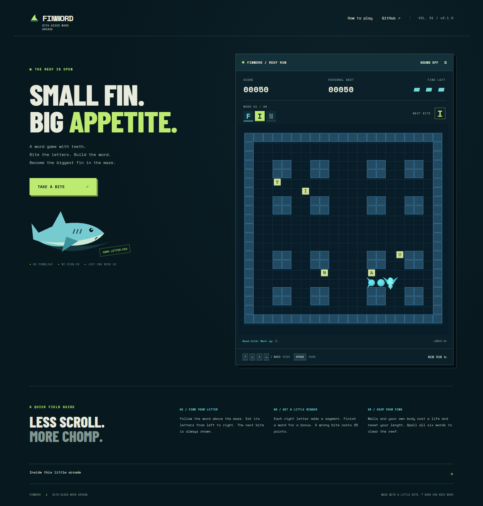

# FINWORD

**A little shark. A big appetite for words.**

A standalone retro browser arcade: steer a growing shark through a neon block maze and eat letters to spell six ocean words. Original procedural Three.js artwork, keyboard and touch controls, a relaxed Cruise mode and a faster Arcade mode.

[Play Finword](https://blackstackdev.github.io/finword-arcade/)



## Play

Select **Let’s swim**. Use arrows / WASD, the touch buttons or a swipe to steer. Collect the target word's letters from left to right. Each correct letter grows your shark and earns 50 points. Complete a word for a bonus. A wrong letter costs 25 points. Walls and your own body cost a life and reset length while retaining word progress. Three lives; six words to clear the reef.

Space pauses when the maze is focused. The pause button works on all layouts. Switching away pauses the run. Sound starts off and can be enabled. Your best score and sound preference save locally when browser storage is available.

## Run locally

Node.js 22.12+ (tested with 22.17.1) and npm.

```sh
npm ci
npm run dev
```

Open the loopback URL Vite prints. Production build: `npm run build`; local production preview: `npm run preview`. The site is static and supports GitHub Pages project paths.

## Checks

```sh
npm test
npx playwright install chromium
npm run test:browser
npm run build
```

11 simulation checks and 8 Chromium browser scenarios across desktop and mobile emulation. Browser tests navigate an entire run with keyboard events and a deterministic development-only simulation step hook. A separate timed check verifies the real animation loop. Production builds omit the hook. See [verification](docs/QA.md) for coverage and limits.

## Structure

- `src/game.js`: deterministic grid simulation, words, scoring, movement and collision.
- `src/render.js`: Three.js scene adapter and Canvas 2D fallback.
- `src/main.js`: input, DOM interface, sound, browser persistence and loop.
- `src/style.css`: responsive arcade website.
- `tests/`: simulation and browser acceptance checks.

The game makes no API calls, has no account system or analytics, and loads fonts from its own build. GitHub hosts the website. Best scores are browser-local, not a shared leaderboard. The 2D fallback supports browsers without WebGL 2 and recovers a lost graphics context.

## Status and credits

v0.1.0 — public browser prototype. Physical phone comfort and longer player sessions still need feedback. No native installer or app-store build is included. [Changelog](CHANGELOG.md).

A Krēˈādiv Worx game. Product direction: Raiden. Implementation: Codi.

Original game code and art: © 2026 Krēˈādiv Worx. All rights reserved; no open-source license is granted for original material. Third-party software and fonts retain their own licenses; complete notices ship in `public/licenses/`. Report reproducible game bugs through this repository's Issues, without personal information.

Implementation references: [Three.js renderer](https://threejs.org/docs/pages/WebGLRenderer), [orthographic camera](https://threejs.org/docs/pages/OrthographicCamera), [GitHub Pages workflows](https://docs.github.com/en/pages/getting-started-with-github-pages/using-custom-workflows-with-github-pages).
